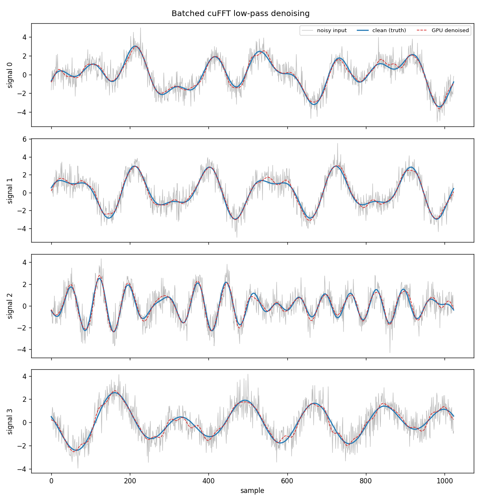
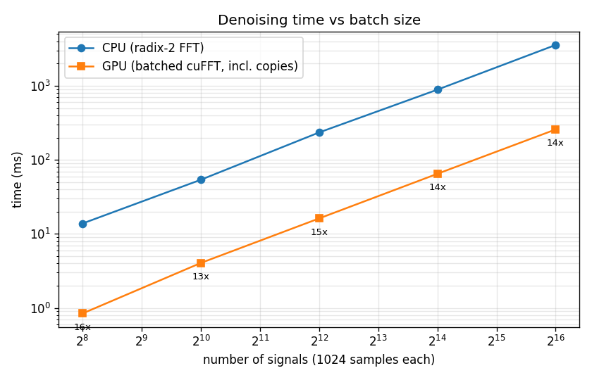

# Batched GPU Signal Denoising with cuFFT

GPU Specialization capstone project. The program removes high-frequency noise
from thousands of 1-D signals at once using a **batched cuFFT low-pass
filter**, checks every output against a CPU FFT implementation, and measures
how the GPU and CPU scale as the batch grows.



## What it does

1. **Generates data.** Each signal is the sum of three sine tones (random
   frequency, amplitude, phase) plus Gaussian noise. Because the clean signal
   is known, the result can be measured, not just eyeballed.
2. **Filters on the GPU.** All signals are copied to the GPU in one transfer and
   processed with:
   - one batched real-to-complex FFT (`cufftPlanMany`, `CUFFT_R2C`),
   - a custom CUDA kernel (`LowPassKernel`) with one thread per frequency bin
     that zeroes bins at or above the cutoff and scales the rest by 1/N,
   - one batched complex-to-real inverse FFT (`CUFFT_C2R`).
3. **Filters on the CPU** with a hand-written radix-2 Cooley-Tukey FFT doing
   the same maths, one signal at a time.
4. **Verifies and reports.** Prints the max |GPU − CPU| difference (the run is
   marked `VERIFIED` below 1e-3), the signal-to-noise ratio before and after,
   and per-stage GPU timings (copies, FFT, filter kernel, inverse FFT) taken
   with CUDA events.

## Repository layout

```
src/main.cu          CLI parsing, run orchestration, CSV output
src/gpu_denoise.cu   cuFFT plans, LowPassKernel, CUDA-event timing
src/cpu_fft.cpp      CPU radix-2 FFT and reference low-pass filter
src/signals.cpp      Synthetic signal generation, SNR and diff metrics
scripts/plot_results.py  Turns the CSVs into PNG plots
colab_run.ipynb      One-click Google Colab notebook (build, run, plots)
Makefile             Builds bin/fft_denoise with nvcc + cuFFT
run.sh               Builds, runs the full benchmark sweep, makes plots
output/              Results from my run (logs, CSVs, plots)
```

## Requirements

- NVIDIA GPU and the CUDA Toolkit (`nvcc`, cuFFT). Results in `output/` were
  produced on Google Colab with a T4 GPU.
- `make` and a C++17 host compiler.
- Optional, for plots: Python 3 with `matplotlib` (`pip install matplotlib`).

## Run on Google Colab (no local GPU needed)

1. Open `colab_run.ipynb` in [Google Colab](https://colab.research.google.com)
   (File → Upload notebook).
2. Runtime → Change runtime type → **T4 GPU**.
3. Run all cells. The notebook builds the code, runs the sweep, shows the
   plots and downloads `output.zip`.

## Build and run

```bash
make                 # builds bin/fft_denoise
./run.sh             # full benchmark sweep + plots, results in output/
```

`run.sh` runs batches of 256, 1,024, 4,096, 16,384 and 65,536 signals of 1,024
samples each (up to 64 million samples in one run), then a final run that saves
a few signals for the before/after plot.

To run a single configuration:

```bash
./bin/fft_denoise --num_signals=8192 --length=2048 --cutoff=64 --noise=1.0
make run ARGS="--num_signals=8192 --save_examples=4"
```

### Command-line options

| Option | Default | Meaning |
|---|---|---|
| `--num_signals=N` | 4096 | Signals in the batch |
| `--length=L` | 1024 | Samples per signal (power of two, ≥ 8) |
| `--cutoff=C` | 32 | Keep frequency bins below C (2 ≤ C ≤ L/2) |
| `--noise=S` | 0.8 | Standard deviation of the added Gaussian noise |
| `--seed=X` | 42 | Random seed, for reproducible runs |
| `--output_dir=DIR` | output | Where CSV results are written |
| `--save_examples=K` | 0 | Also write the first K signals to `examples.csv` |
| `--help` | | Print usage |

The program exits with a non-zero status if the GPU and CPU results disagree.

## Output files

| File | Contents |
|---|---|
| `output/run_log.txt` | Console output of every run in the sweep |
| `output/summary.csv` | One row per run: sizes, CPU and GPU times (per stage), speedup, SNR in/out, max diff |
| `output/examples.csv` | Sample-by-sample clean, noisy, CPU and GPU output for a few signals |
| `output/example_signals.png` | Before/after plot of those signals |
| `output/timing.png` | CPU vs GPU time across batch sizes, with speedups |

## Results (Google Colab, Tesla T4)

| Signals | CPU | GPU end to end | Speedup | GPU compute only | Host↔device copies |
|---|---|---|---|---|---|
| 256 | 13.8 ms | 0.84 ms | 16× | 0.09 ms | 0.75 ms |
| 1,024 | 53.9 ms | 4.05 ms | 13× | 0.14 ms | 3.91 ms |
| 4,096 | 235.6 ms | 16.0 ms | 15× | 0.44 ms | 15.6 ms |
| 16,384 | 887.8 ms | 64.9 ms | 14× | 1.83 ms | 63.0 ms |
| 65,536 | 3,569.6 ms | 257.6 ms | 14× | 7.07 ms | 250.6 ms |

All runs verified (max |GPU − CPU| = 2×10⁻⁵). Average SNR improves from
3.7 dB to 15.9 dB.

The GPU's compute stages (FFT, filter, inverse FFT) are about 500× faster than
the CPU, but copying data across PCIe takes ~97% of the GPU time, which caps
the end-to-end speedup at ~14×. Pinned memory and CUDA streams to overlap
copies with compute are the obvious next optimization.



## Design notes

- **Batching is the point.** One `cufftPlanMany` call handles every signal, so
  the GPU sees a single large job instead of thousands of tiny ones. Plans are
  created before timing starts, as a real application would reuse them.
- **R2C/C2R transforms** exploit the fact that the input is real: the spectrum
  of each signal is only L/2 + 1 bins, halving memory and work compared with a
  complex FFT. The CPU version uses a full complex FFT and zeroes the mirrored
  bins, which gives the same result.
- **Normalization.** cuFFT's inverse is unnormalized, so the filter kernel
  multiplies the kept bins by 1/N. Folding this into the kernel avoids an extra
  pass over the data.
- **Fair timing.** The CUDA context is created before timing (`InitGpu`), and
  the GPU time includes both host↔device copies, so the speedup is end to end.

## Code style

The C++ follows the Google C++ Style Guide: `CamelCase` functions and types,
`snake_case` variables, `kConstant` names, header guards, a project namespace,
2-space indentation and 80-column lines.

## Author

Divjot (IIIT Delhi), GitHub [@Divjotflora](https://github.com/Divjotflora)
